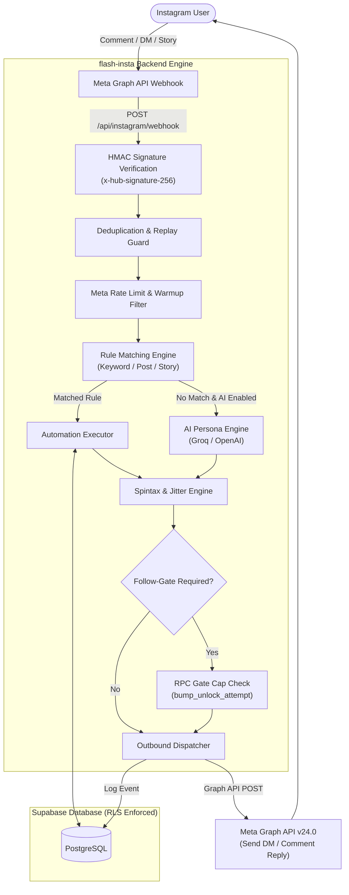

# ⚡ flash-insta

> **Enterprise Instagram DM, Comment & Engagement Automation Platform**  
> *Proprietary & Confidential — All Rights Reserved*

---

## 📌 Overview

**flash-insta** is a high-performance, AI-native Instagram engagement and conversion automation platform built for creators, high-growth brands, and marketing agencies. It bridges Meta's official Instagram Graph API (v24.0) with an intelligent automation engine, deliverability safeguarding, and real-time live inbox management.

Unlike generic bots or brittle scrapers, **flash-insta** operates 100% within Meta's sanctioned API boundaries, featuring an advanced deliverability engine (Spintax variations, human jitter, account warmup), multi-account switching, follow-gated conversion funnels, and an interactive phone simulator for live previewing.

---

## 🔒 Confidentiality & License Notice

This repository contains proprietary software and confidential intellectual property belonging to the organization. 
- **Unauthorized copying, distribution, decompilation, public hosting, or commercial exploitation of any part of this codebase is strictly prohibited.**
- Access is restricted exclusively to authorized internal engineers, contributors, and administrators under signed non-disclosure agreements.

---

## ✨ Core Feature Highlights

### 👥 1. Multi-Account Fleet Management & Switching
- **Seamless Account Linking:** Link multiple Instagram Creator and Business accounts under a single master profile (`@ee.info` default).
- **Instant Account Switching:** Fast switching via `/api/auth/switch-account` with zero session desynchronization.
- **Dynamic Profile & Asset Sync:** Automatically synchronizes display pictures, profile metadata, follower metrics, and permissions per account.
- **Account Unlinking & Cleanup:** Graceful disconnection with full token invalidation and token rotation safeguards.

### 📱 2. Hyper-Interactive Live Phone Simulator
- **Stationary Phone Simulator:** Built directly into the automation builder for rapid visual feedback.
- **Interactive Comment Typing:** Real-time comment input field to test keyword triggers on the fly.
- **In-App Push Simulation:** Simulates native iOS push notifications when an automation triggers.
- **End-to-End Visual Funnel:** Walk through the complete sequence: comment submission &rarr; public reply &rarr; notification &rarr; DM thread &rarr; card interaction.

### 🔐 3. Advanced Follow-Gate Conversion Funnels
- **Stepped Unlock Verification:** Two-stage gated cards requiring users to follow the account before content is unlocked.
- **Customizable Locked/Unlocked Cards:** Independent media assets, button labels, and custom destination URLs for locked vs. unlocked states.
- **RPC-Backed Abuse Protection:** Rate-limits unlock attempts (`bump_unlock_attempt` PostgreSQL RPC) with a strict 3-attempt safety cap.
- **Live Simulator Stages:** Test both locked and unlocked simulator views before publishing rules.

### 🛡️ 4. Anti-Spam & Deliverability Engine
- **Dynamic Spintax Variations:** Engine resolves `{Hi|Hey|Hello} {there|friend}!` syntax to prevent automated text repetition penalties from Meta spam filters.
- **Human Jitter Timing:** Introduces randomized, human-like reaction intervals before message dispatch.
- **Account Warmup Curves:** Enforces phased daily messaging limits to safely warm up new Instagram connections.
- **Meta Rate Limit Sentinel:** Real-time inspection of `x-app-usage` and `x-business-use-case-usage` headers with exponential backoff.
- **Opt-Out Compliance:** Built-in listener for `STOP`, `UNSUBSCRIBE`, and `CANCEL` keywords to immediately halt automated outreach.
- **Single Public Reply Deduplication:** Guarantees only one public comment reply is posted per user on any trigger event.

### 🤖 5. Context-Aware AI Auto-Replies
- **Groq & OpenAI Compatible:** High-speed LLM integration for handling unmatched inquiries.
- **Custom Persona Engine:** Per-account system prompt customization, conversational tone matching, and knowledge boundaries.
- **Contextual Memory:** Ingests recent thread history for contextually aware multi-turn responses.
- **Simulated Typing Behavior:** Sends Instagram typing indicator signals to create authentic user interactions.

### 💬 6. Comment, Story & DM Trigger Automations
- **Comment-to-DM Funnels:** Single-post, multi-post, or global comment triggers with simultaneous public reply and private DM delivery.
- **Story Reply & Mention Automations:** Instant response to story replies, mentions, and emoji reactions with resilient token recovery.
- **Keyword Matching Engine:** Exact match, phrase match, and multi-keyword options with radio button configuration.
- **Custom Suggestions & Quick Replies:** Up to 4 customizable quick suggestions synchronized directly with Instagram Messenger Profile.

### 📥 7. Unified Real-Time Inbox & Live Chat
- **Multi-Account Threads:** Consolidated inbox view across linked Instagram accounts.
- **Live Human Intervention:** Pause automations and seamlessly take over conversations manually.
- **Complete Message Auditing:** Comprehensive historical logs of inbound user messages and outbound automated responses.

### 🛰️ 8. High-Observability Admin NOC & Control Plane
- **Fleet Telemetry:** Real-time overview of connected accounts, message queues, webhook throughput, and error rates.
- **User & Account Search:** Rapid filtering and lookup of creators, linked pages, and active automations.
- **Audit Trails:** Centralized security and operational logs for fleet management and troubleshooting.

---

## 🧱 Technical Stack

| Layer | Technology | Details |
|---|---|---|
| **Framework** | Next.js 16 (App Router) | React Server Components, Server Actions, Serverless API Routes |
| **Frontend** | React 19, TypeScript, Tailwind CSS | shadcn/ui primitives, Radix UI, Lucide React, Framer Motion |
| **Database** | Supabase PostgreSQL | Row Level Security (RLS), PL/pgSQL RPCs, Migration Runner |
| **Authentication** | Cryptographic Session Cookies | HMAC SHA-256 signed payloads, edge session verification |
| **Instagram API** | Meta Graph API v24.0 | Official Instagram Login, Webhooks, Messenger Profile API |
| **AI Engine** | Groq / OpenAI LLM Proxy | High-throughput streaming, contextual memory, persona tuning |
| **Hosting & Ops** | Vercel | Serverless edge execution, Vercel Analytics, Cron automation |

---

## 🏗️ System Architecture



---

## 📁 Repository Structure

```txt
flashinsta/
├── app/
│   ├── (auth)/                  Authentication views and OAuth redirects
│   ├── admin/                   Admin NOC control plane & fleet observability
│   ├── api/
│   │   ├── admin/               Fleet management and telemetry endpoints
│   │   ├── auth/                Account linking, session, switching & tokens
│   │   ├── automations/         Automation rule CRUD and execution endpoints
│   │   ├── business-profile/    Instagram business profile sync
│   │   ├── dashboard/           Dashboard metrics and analytics endpoints
│   │   ├── groq/                AI auto-reply proxy and settings
│   │   ├── ice-breakers/        Messenger profile Ice Breakers sync
│   │   ├── inbox/               Live conversation and manual messaging APIs
│   │   ├── instagram/           Meta OAuth callback, webhooks & media sync
│   │   ├── privacy/             GDPR data export and account deletion endpoints
│   │   └── upload/              Media asset upload handler
│   ├── dashboard/               Core creator dashboard (Automations, Inbox, Analytics)
│   ├── privacy/                 Public Privacy Policy and compliance notices
│   ├── terms/                   Terms of Service
│   └── layout.tsx               Root layout, theme provider, and font definitions
├── components/
│   ├── dashboard/               CreateRuleForm (with Simulator), ConnectModal, AssistantSettings
│   ├── inbox/                   Real-time chat window and thread components
│   ├── layout/                  Navbar, Sidebar, and shell navigation
│   └── ui/                      Design system primitives (Radix UI / Tailwind)
├── lib/
│   ├── account-links.ts         Multi-account linking, discovery and candidate resolution
│   ├── admin-auth.ts            Admin NOC access verification
│   ├── ai-reply.ts              LLM integration, context retrieval, and persona prompt
│   ├── dedup.ts                 Idempotency and message deduplication
│   ├── instagram-api.ts         Meta Graph API v24.0 client, card & button builders
│   ├── jitter.ts                Humanized response timing delays
│   ├── meta-rate-limit.ts       Meta Graph API rate limit monitoring & backoff
│   ├── opt-out.ts               STOP/UNSUBSCRIBE compliance handling
│   ├── session.ts               Cryptographic session signing & verification
│   ├── spintax.ts               Text permutation generator {option1|option2}
│   ├── supabase-admin.ts        Service-role database client
│   ├── supabase-migrate.ts      Runtime database schema migration runner
│   ├── supabase-server.ts       Authenticated client with Row Level Security
│   ├── unlock-tracking.ts       Follow-gate 3-attempt safety cap logic
│   └── warmup.ts                Phased messaging volume warmup curve
├── schema.sql                   Canonical PostgreSQL database schema & RLS policies
└── SECURITY_MAP.md              Application security architecture & audit ledger
```

---

## 🛠️ Internal Setup & Local Development

### 1. Prerequisites
- **Node.js:** v20+ LTS or v22+
- **Package Manager:** `npm` (or `pnpm`)
- **Supabase Account:** Dedicated project with PostgreSQL 15+
- **Meta Developer Account:** Verified Meta App with Instagram Graph API access

### 2. Installation
Clone the internal repository into your workspace:

```bash
git clone https://github.com/manoj402kumar/flashinsta
cd flashinsta
npm install
```

### 3. Database Initialization
1. Open the **SQL Editor** in your Supabase project.
2. Execute the entire contents of [`schema.sql`](file:///home/yenigandlamanojkumar/Desktop/Projects/flashinsta/schema.sql).
3. Verify that all 12 core tables and security policies are active:
   ```sql
   SELECT count(*) FROM information_schema.tables 
   WHERE table_schema = 'public' AND table_type = 'BASE TABLE';
   
   SELECT proname FROM pg_proc WHERE proname = 'bump_unlock_attempt';
   ```

### 4. Environment Variables Configuration
Create a local `.env.local` file in the root directory:

```env
# ─── Supabase Configuration ───────────────────────────────────
NEXT_PUBLIC_SUPABASE_URL=https://your-project.supabase.co
NEXT_PUBLIC_SUPABASE_ANON_KEY=eyJhbGciOi...
SUPABASE_SERVICE_ROLE_KEY=eyJhbGciOi...

# ─── Meta / Instagram Graph API ───────────────────────────────
NEXT_PUBLIC_INSTAGRAM_APP_ID=123456789012345
INSTAGRAM_APP_ID=123456789012345
INSTAGRAM_APP_SECRET=your_meta_app_secret
NEXT_PUBLIC_INSTAGRAM_REDIRECT_URI=http://localhost:3000/api/instagram/callback
INSTAGRAM_WEBHOOK_VERIFY_TOKEN=your_secure_webhook_token

# ─── Cryptographic & Operational Secrets ──────────────────────
SESSION_SECRET=your_random_64_char_hex_secret
GATEWAY_SECRET=your_internal_gateway_secret
API_SECRET_KEY=your_internal_upload_hook_key

# ─── AI Engine Configuration (Groq / OpenAI) ─────────────────
GROQ_API_KEY=gsk_your_groq_api_key
OPENAI_API_KEY=sk-your_openai_key
```

### 5. Running Local Server

```bash
npm run dev
```

Navigate to [http://localhost:3000](http://localhost:3000) to access the platform.

To run type checks and compile verification:
```bash
npx tsc --noEmit
```

---

## 🚀 Production Deployment & Operations

### 1. Vercel Deployment
The platform is optimized for zero-cold-start execution on Vercel:
1. Connect the repository to Vercel.
2. Configure all environment variables in the project settings.
3. Configure the canonical production URL in [`middleware.ts`](file:///home/yenigandlamanojkumar/Desktop/Projects/flashinsta/middleware.ts#L6-L7) and [`components/layout/landing-page.tsx`](file:///home/yenigandlamanojkumar/Desktop/Projects/flashinsta/components/layout/landing-page.tsx#L33).

### 2. Meta Webhook Registration
1. In the **Meta for Developers Console**, go to **Instagram &rarr; Webhooks**.
2. Set the Callback URL to:
   ```txt
   https://your-domain.com/api/instagram/webhook
   ```
3. Set the **Verify Token** matching `INSTAGRAM_WEBHOOK_VERIFY_TOKEN`.
4. Subscribe to the following webhook fields:
   - `messages` (Inbound DMs, postbacks, quick replies)
   - `messaging_postbacks` (Button clicks and follow-gate verification)
   - `comments` (Post comments and mentions)
   - `messaging_seen` (Read receipts)

### 3. Meta App Review Requirements
For public usage across non-tester Instagram accounts, the Meta App must have the following approved permissions:
- `instagram_business_basic`
- `instagram_business_manage_messages`
- `instagram_business_manage_comments`

Refer to [`META_APPROVAL_GUIDE.md`](file:///home/yenigandlamanojkumar/Desktop/Projects/flashinsta/META_APPROVAL_GUIDE.md) for full screencast recording specifications and verification steps.

---

## 🔐 Security Architecture

- **Session Security:** Session cookies use HMAC SHA-256 signatures with mandatory expiration. Cookie payloads are cryptographically validated on every request.
- **Webhook Authenticity:** Every incoming Meta payload is verified against `x-hub-signature-256` using the `INSTAGRAM_APP_SECRET`.
- **Database Isolation:** PostgreSQL Row Level Security (RLS) is enforced across all tables (`accounts`, `rules`, `analytics`, `assistant_settings`, `ice_breakers`). Client access is restricted strictly to the authenticated `user_id`.
- **Access Token Encryption:** Instagram Access Tokens are refreshed automatically and isolated from client exposure.
- For a comprehensive threat model and vulnerability audit, consult [`SECURITY_MAP.md`](file:///home/yenigandlamanojkumar/Desktop/Projects/flashinsta/SECURITY_MAP.md).

---

<p align="center">
  <strong>flash-insta Engineering</strong> · Internal Technical Documentation
</p>
